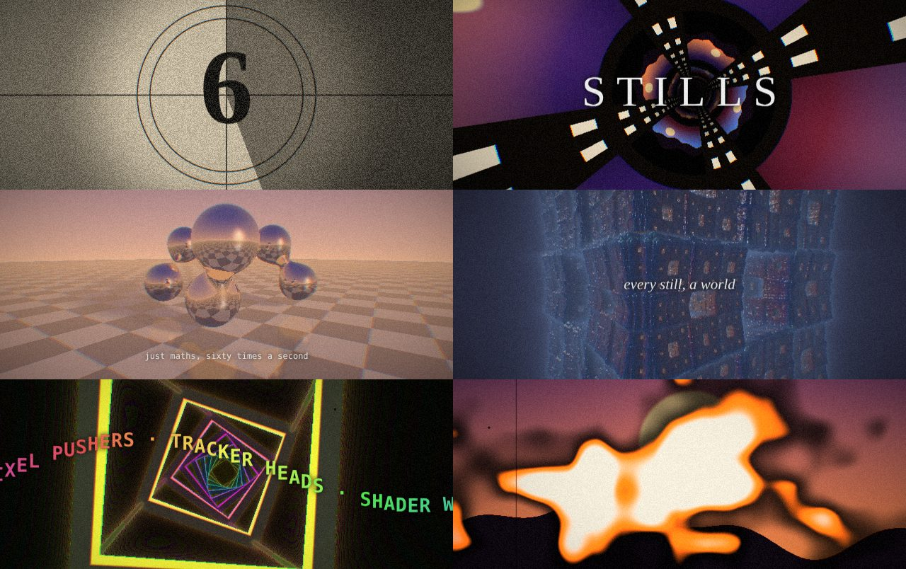
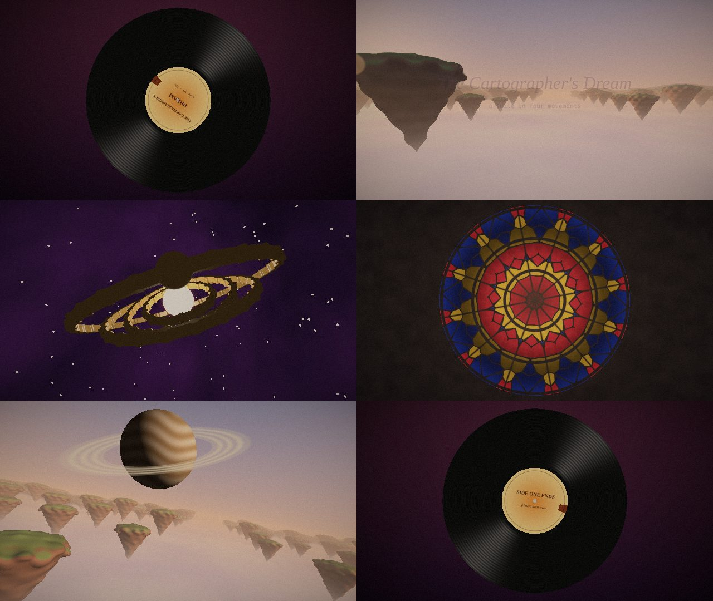

# STILLS — a 16k intro

A small demoscene-style intro that fits in **one 14,931-byte HTML file**, under the 16 KB (16,384-byte) limit.
It uses no external files, libraries, textures or audio samples. Everything you see and hear is
generated in the browser when the page loads.

## Run it

Open `stills.html` in a recent desktop browser (Chrome, Firefox, Safari or Edge) and click.
It plays for about 95 seconds; turn the sound on.

Add a number of seconds after `#` to start partway through, e.g. `stills.html#60`.

## What's inside

**Music** comes from a small software synth. Before playback it renders the whole song
(125 BPM, Am–F–C–G) into an `AudioBuffer`:

- kick drum: a sine wave that sweeps down in pitch
- snare and hi-hats: filtered noise
- bass: a filtered sawtooth
- pads: three detuned saws per note
- arpeggio and lead: each note is played again a few times as a quieter, alternating-side echo
- the countdown: the clatter of a 24 fps projector

The visuals are timed from the audio clock, so they stay in sync.

**Visuals** use two WebGL passes:

| bars | scene |
|------|-------|
| 0–8   | Academy-style countdown leader (sweep, crosshair, 8…1) |
| 8–16  | Tunnel lined with strips of film; every frame is a little procedural "movie still" |
| 16–24 | Raymarched chrome metaballs bouncing on the beat over a checkerboard at sunset (reflections + soft shadows) |
| 24–32 | Breakdown: slowly twisting Menger sponge |
| 32–44 | Twisting neon corridor with a classic sine-wave greetings scroller |
| 44–48 | "THE END" over a final still, then the film burns through |

A post-processing pass makes it all look like it was projected from film:

- chromatic aberration that pulses on the beat
- gate weave and frame flicker
- grain, scratches and dust
- vignette
- 2.39:1 letterbox
- the film burn at the end

---

# The Cartographer's Dream — a 16k prog suite

A second intro, inspired by prog rock: **one 16,284-byte HTML file** (`cartographer.html`).
To fit under 16 KB the source is compacted (no comments, shortened names, the melodies packed into short strings).

It's framed as side one of an LP. The needle drops onto a spinning record, then a four-movement suite (about two minutes) plays:

| time | movement | music | visuals |
|------|----------|-------|---------|
| 0:00 | needle drop | vinyl crackle | a spinning record, label text turning with it |
| 0:06 | i. the gathering mist | 4/4 at 80 BPM: Mellotron strings, flute melody, gong | sunrise over a sea of cloud with floating islands |
| 0:27 | ii. clockwork sky | 7/8 (2+2+3): Hammond organ stabs, bass riff, Moog lead | a brass orrery whose rings tick round on the accents of the riff |
| 0:55 | iii. glass cathedral | 5/4: twelve-string guitar arpeggios, flute | a stained-glass rose window; panes light up with each note |
| 1:19 | iv. ascension | 7/8 reprise into a 4/4 finale with a Moog solo, ending on a big D major chord | flying among the islands under a ringed planet, fading to white |
| 1:48 | run-out groove | crackle, the needle clicking every turn | "side one ends · please turn over" |

The synth includes a tonewheel-organ wavetable with a rotating-speaker wobble, Mellotron-like
strings and flute with tape wobble, a monophonic Moog-style lead that glides between notes through a resonant filter,
plucked-string synthesis for the twelve-string, drums, toms and a gong, plus a reverb. The Moog solo in the
finale is improvised by a random walk over the D major scale, so it's different every time.
